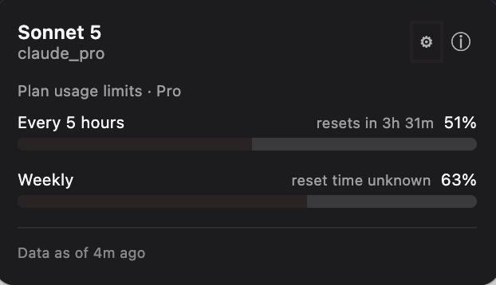
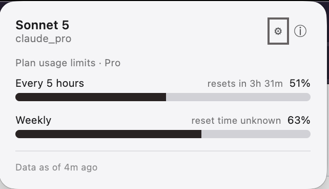
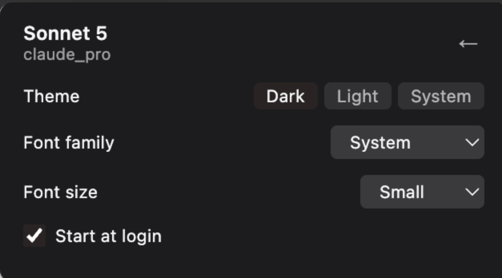
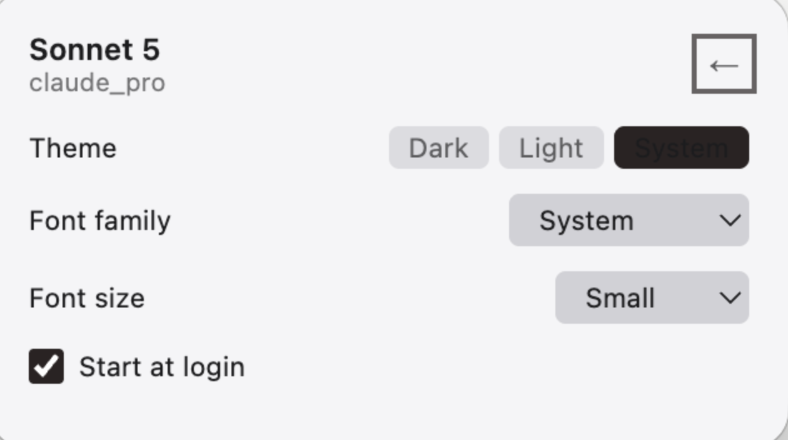

<div align="center">

# token-pulse

**Your Claude usage, always one glance away.**

A lightweight tray/menu-bar widget for macOS, Windows, and Linux that shows your Claude 5-hour and weekly rate-limit usage — without ever opening Claude Desktop.


<p>
  
  
</p>

</div>

---

## Contents

- [Features](#features)
- [How it gets its numbers](#how-it-gets-its-numbers)
- [Settings](#settings)
- [Requirements](#requirements)
- [Running a dev instance](#running-a-dev-instance)
- [Building an installer](#building-an-installer)
- [Project layout](#project-layout)
- [Known limitations](#known-limitations)

## Features

- **Two usage rings** — 5-hour and weekly rate-limit percentage, with a countdown to reset
- **Context window usage** — current conversation's token usage against the model's context window, when available
- **Live urgency color** on the tray icon — blue under 80%, dark yellow from 80%, dark red from 90%
- **OS-aware tray icon** — the normal-state ring color follows your system's light/dark menu-bar appearance automatically
- **Runs in the background** — no Dock icon, no entry in the app switcher; lives entirely in the tray
- **Settings** — dark/light/system in-app theme, font family & size, and a working "Start at login" toggle
- **About panel** — version info and a contact link, one click away
- 100% local — no network calls, no credentials, no telemetry

## How it gets its numbers

token-pulse reads **Claude Desktop's own local history file** — the same data Desktop's usage panel is built from:

| Platform | Path |
|---|---|
| macOS | `~/Library/Application Support/Claude/plan-usage-history.json` |
| Windows | `%APPDATA%\Claude\plan-usage-history.json` |
| Linux | `~/.config/Claude/plan-usage-history.json` |

Claude Desktop appends a sample to this file roughly every 5 minutes while it's running. Each sample carries a timestamp and the current 5-hour/weekly usage percentages; token-pulse filters samples to your active org (via `oauthAccount.organizationUuid` in `~/.claude.json`) and derives:

- **Current usage** — the most recent sample's percentages
- **Reset time** — approximated by detecting the last percentage *drop* between two samples (a reset event) and anchoring on the midpoint between them. If the gap between those two samples is unusually large (>15 minutes — Desktop was asleep or closed), it anchors on the later sample instead, since the real reset most likely happened just before sampling resumed.

The current **model name** is read from the newest entry in `~/.claude/projects/**/*.jsonl` (session transcripts, written by both the CLI and Desktop), since the statusline hook cache never updates outside a CLI session; it falls back to that cache (`~/.claude/token-pulse-cache.json`, populated by `~/.claude/statusline-command.sh`) if no transcript is found. **Context window usage** still comes from the statusline cache — Desktop has no equivalent. **Plan tier** comes from `~/.claude.json`'s `oauthAccount.organizationType`. Everything is read locally, driven by a file watcher on all of the above (with a 60s fallback poll in case a watch event is missed) — no API calls, ever.

**Freshness depends on Desktop, not on token-pulse.** Since Desktop only writes a new sample every ~5 minutes, the popup's "Data as of Xm ago" line reflects how recently *Desktop* last sampled — not how often token-pulse reads the file (which is much more frequent, every 5s). A few minutes of staleness between Desktop's own writes is normal.

## Settings

Click the ⚙ icon in the popup header to open Settings:

<p>
  
  
</p>

| Control | Options |
|---|---|
| Theme | Dark / Light / System (follows the OS appearance) |
| Font family | System / Monospace / Serif / Menlo / JetBrains Mono |
| Font size | Small / Medium / Large |
| Start at login | On / Off |

Settings persist to disk and survive restarts. Click ⓘ for the About panel; click ← from either view to return to the usage screen.

## Requirements

- Node.js 22+ and npm, for the dev/build tooling (Vite, Electron, TypeScript)
- Claude Desktop installed and run at least once (so `plan-usage-history.json` exists)
- `jq` installed, if you also want the model-name statusline block active (almost certainly already on your machine if you have a statusline configured)

## Running a dev instance

```bash
npm install
npm run dev
```

This starts Vite (renderer) and launches Electron with hot-reload for both the popup UI and the main process. A tray/menu-bar icon appears (a colored ring) — click it to open the popup. Right-click the tray icon for a "Quit" option; the app has no other way to exit, since it's designed to live in the background (`window-all-closed` is intentionally a no-op, and the app has no Dock icon on macOS).

### Tests and type-checking

```bash
npm test                            # vitest — pure logic (format helpers, tray icon pixels, provider, settings, autostart) is unit-tested
npx tsc -p tsconfig.json --noEmit   # strict type-check
```

Electron-runtime glue (`electron/*.ts`) has no unit tests, since `Tray`/`BrowserWindow`/`app` APIs aren't meaningfully mockable — that layer is verified manually via `npm run dev` and the packaged app.

## Building an installer

```bash
npm run build
```

This runs `tsc --noEmit && vite build && electron-builder`, producing installers under `release/<version>/`:

| Platform | Output | Notes |
|---|---|---|
| macOS | `token-pulse-Mac-<version>-Installer.dmg` + an unpacked `<arch>/token-pulse.app` | Unsigned by default (no Apple Developer ID configured) — macOS Gatekeeper will warn on first launch; right-click → Open, or codesign it yourself if you have a certificate. |
| Windows | `token-pulse-Windows-<version>-Setup.exe` (NSIS installer) | Must be built on Windows, or on macOS/Linux with `wine` installed. Not build-verified on this machine. |
| Linux | `token-pulse-Linux-<version>.AppImage` and a `.deb` | Must be built on Linux (or with electron-builder's Docker-based cross-build image). Not build-verified on this machine. |

electron-builder only cross-builds some targets from macOS without extra tooling — building the Windows/Linux installers for real is easiest done on (or in a container for) that target OS. The config for all three lives in `electron-builder.json5` and doesn't need changes to add a platform's build — just run `npm run build` on that OS.

To launch the packaged macOS app directly instead of via the dmg:

```bash
open release/<version>/mac-arm64/token-pulse.app   # or mac-x64 / mac, depending on your Mac's architecture — check `ls release/<version>/`
```

## Project layout

```
electron/                  Main-process entry, tray icon wiring, popup window, autostart (not unit-tested — Electron runtime APIs)
src/
  providers/claude-code/    Reads plan-usage-history.json + statusline cache + ~/.claude.json (ClaudeCodeProvider)
  main/                     Pure logic used by the main process (tray icon PNG rendering, settings persistence, Linux autostart entry)
  shared/                   Types and formatting helpers shared between main and renderer
  components/               Popup UI (React) — WidgetPanel (nav shell), UsageView, SettingsView, AboutView
tests/                      Vitest unit tests for everything above except electron/*
docs/superpowers/           Design specs and implementation plans this project was built from
```

## Known limitations

- Rate-limit data is only as fresh as Claude Desktop's last local write — there's no way to pull live numbers on demand outside of that.
- The current model name still depends on the Claude Code statusline hook cache; usage percentages do not.
- Windows and Linux packaging is configured but not build-or-run verified (this project was built and tested on macOS only).
- No automated tests exist for the Electron main-process glue (`electron/*.ts`) or for React component rendering — both are verified manually rather than via unit tests.
