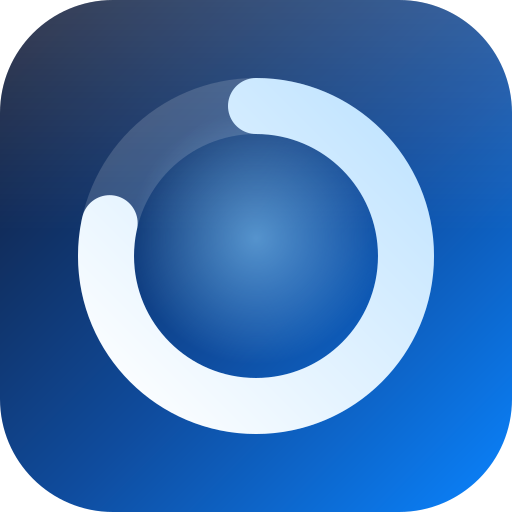
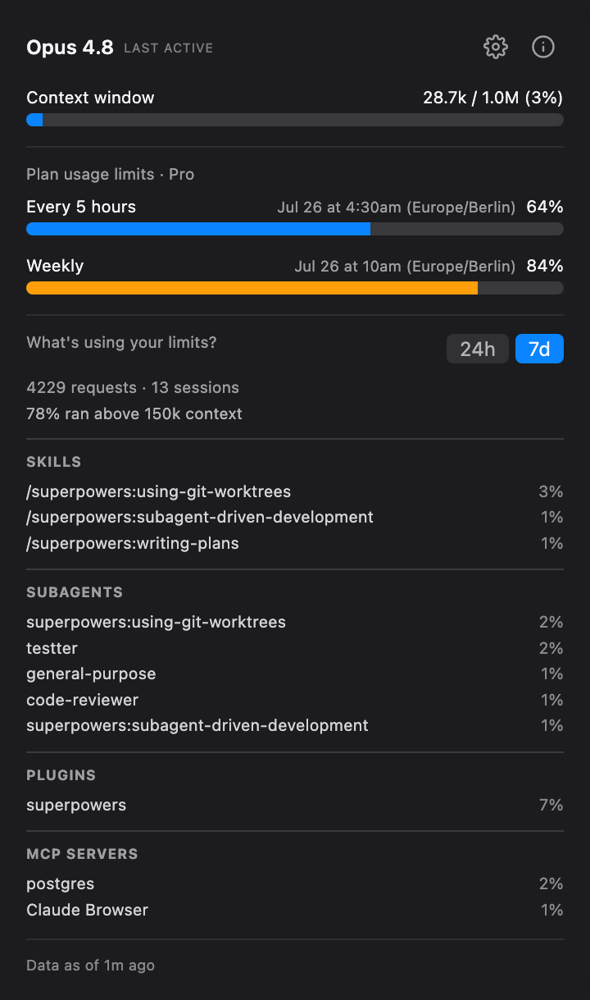
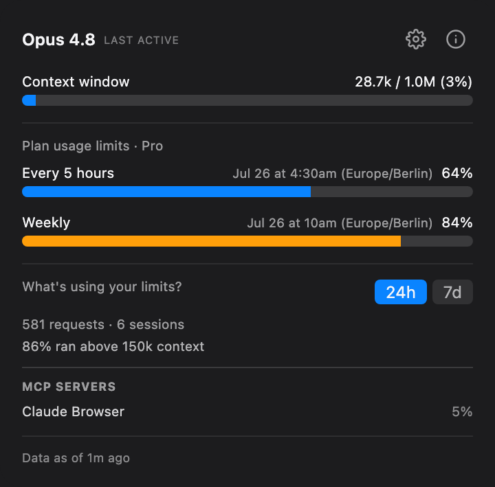
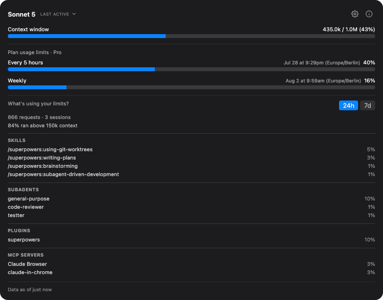
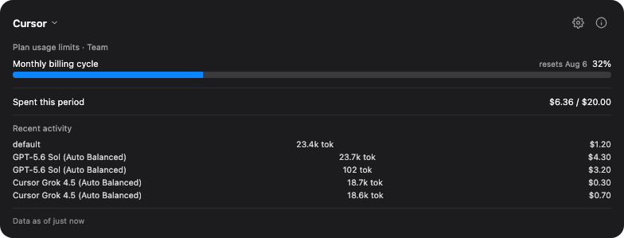
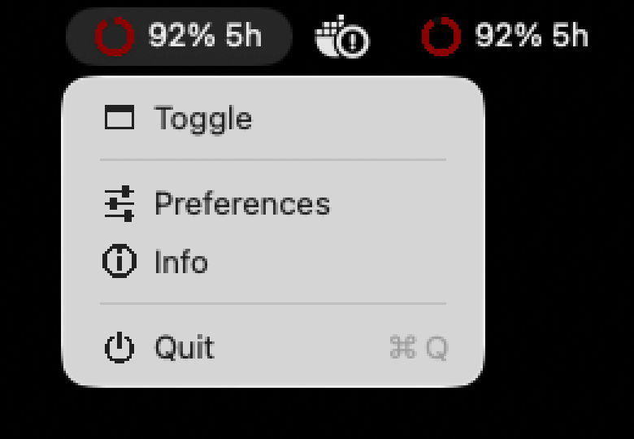
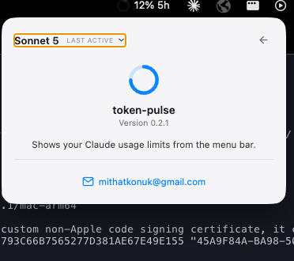

<div align="center">



# token-pulse

**Your Claude and Cursor usage, always one glance away.**

A lightweight tray/menu-bar widget for macOS, Windows, and Linux that shows your Claude usage — 5-hour and weekly rate limits, without ever running `/usage` yourself — and, if Cursor is installed and logged in, its usage too: monthly billing-cycle %, cost, and recent activity. Either source, one glance.

### 🔒 Nothing to sign into, ever — no accounts, no API keys, no passwords typed in.

token-pulse never asks you to create a credential. It reuses the Anthropic session your `claude` CLI is already logged into, and — if Cursor's installed — the access token Cursor's own desktop app already saved locally. Nothing is entered here, and nothing leaves your machine except calls made with auth you already had.


<p>
  
  
</p>

</div>

---

## Contents

- [Features](#features)
- [How it gets its numbers](#how-it-gets-its-numbers)
- [Settings](#settings)
- [Requirements](#requirements)
- [Running a dev instance](#running-a-dev-instance)
- [Building an installer](#building-an-installer)
- [Project layout](#project-layout)
- [Known limitations](#known-limitations)

## Features

- **Two usage bars** — 5-hour and weekly rate-limit percentage, with the plain-language reset time Claude Code itself reports
- **Tray title tells you which window you're looking at** — the menu-bar percentage is suffixed with `5h`, `Wk`, or (for Cursor) `Mo`, so it's never ambiguous which limit is closest to being hit
- **What's using your limits** — a 24h/7d breakdown of top skills, subagents, plugins, and MCP servers, straight from `/usage`
- **Context window usage** — current conversation's token usage against the model's context window, when available
- **Cursor as a second source** — when Cursor is installed and logged in, the header becomes a clickable selector to switch between "Claude Code" and "Cursor"; Cursor's view shows its monthly billing-cycle % and reset date, cost spent vs. plan limit, and a recent-activity list (model, tokens, cost) for your last few requests. If no Cursor session is found, the header looks exactly as it always has — no dropdown, no visual change.
- **Live urgency color** on the tray icon and usage bars — blue under 80%, yellow/dark yellow from 80%, red/dark red from 90%
- **OS-aware tray icon** — the normal-state ring color follows your system's light/dark menu-bar appearance automatically
- **Runs in the background** — no Dock icon, no entry in the app switcher; lives entirely in the tray
- **Settings** — dark/light/system in-app theme, font family & size, and a working "Start at login" toggle
- **About panel** — version info and a contact link, one click away
- No credentials handled or stored — everything runs through your existing `claude` CLI session (Claude) or a token already saved locally by the Cursor desktop app (Cursor), read-only

## How it gets its numbers

### Claude Code

<p>
  
</p>

- **Usage bars & limits breakdown** — runs `claude -p "/usage"` as a real subprocess, from its own scratch directory, cleaning up the transcript it creates. It's the only network call the app makes. Polls every 3 minutes while active, backing off to every 10 minutes after 15 minutes of inactivity.
- **Model name & context window** — read live from your newest session transcript (`~/.claude/projects/**/*.jsonl`), so it works for both CLI and Desktop sessions. Falls back to an optional personal statusline cache (`~/.claude/token-pulse-cache.json`) if no transcript is available.
- **Plan tier** — read from `~/.claude.json`.

These are driven by a file watcher (60s fallback poll if an event is missed) — no extra process spawns for model/context/plan-tier updates.

### Cursor

<p>
  
</p>

If Cursor's desktop app is installed and logged in, token-pulse reads the access token it already stores locally and calls Cursor's own (unofficial, undocumented) dashboard API directly — the same data Cursor's own UI shows: monthly billing-cycle %, cost, and your 5 most recent requests. Polls every 5 minutes while active, with backoff on failure since this API isn't officially supported.

The token-count/cost fields on the recent-activity list are reverse-engineered and the most likely to drift if Cursor changes its API. If no Cursor token is found, none of this runs — the header looks exactly as it always has.

## Settings and Info

The menu-bar percentage always tells you which window it's from — `5h` (five-hour), `Wk` (weekly), or `Mo` (Cursor's monthly billing cycle):

<p>
  
</p>

Both Settings and the About panel live behind a right-click, not in the popup header — right-click the tray icon for the app menu: **Toggle** opens/closes the popup, same as a left-click; **Preferences** and **Info** open the popup straight to that view; then **Quit**. Each item gets a small hand-drawn icon (window / sliders / info circle / power), matching the icon-plus-label style of other menu-bar apps:

<p>
  
</p>

<p>
  
  
  
</p>

| Setting | Options |
|---|---|
| Theme | Dark / Light / System (follows the OS appearance) |
| Font family | System / Monospace / Serif / Menlo / JetBrains Mono |
| Font size | Small / Medium / Large |
| Start at login | On / Off |

Settings persist to disk and survive restarts. Click ← from either view to return to the usage screen.

## Requirements

- Node.js 22+ and npm, for the dev/build tooling (Vite, Electron, TypeScript)
- The `claude` CLI installed and on `PATH`, logged in (usage bars run it directly)
- Nothing else — model name, context window, and plan tier all work out of the box from session transcripts and `~/.claude.json`. A custom statusline script that populates `~/.claude/token-pulse-cache.json` (like the maintainer's own — see "How it gets its numbers" above) is entirely optional and only used as a fallback if a transcript is ever unavailable
- Cursor is entirely optional — if it's not installed, or installed but not logged in, token-pulse just shows Claude usage: no source selector, no Cursor tab, nothing else changes

## Running a dev instance

```bash
npm install
npm run dev
```

This starts Vite (renderer) and launches Electron with hot-reload for both the popup UI and the main process. A tray/menu-bar icon appears (a colored ring) — click it to open the popup. Right-click the tray icon for the app menu — Toggle, Preferences, Info, then Quit; the app has no other way to exit, since it's designed to live in the background (`window-all-closed` is intentionally a no-op, and the app has no Dock icon on macOS).

### Tests and type-checking

```bash
npm test                            # vitest — pure logic (format helpers, tray icon pixels, provider, settings, autostart) is unit-tested
npx tsc -p tsconfig.json --noEmit   # strict type-check
```

Electron-runtime glue (`electron/*.ts`) has no unit tests, since `Tray`/`BrowserWindow`/`app` APIs aren't meaningfully mockable — that layer is verified manually via `npm run dev` and the packaged app.

## Building an installer

```bash
npm run build
```

This runs `tsc --noEmit && vite build && electron-builder`, producing installers under `release/<version>/`:

| Platform | Output | Notes |
|---|---|---|
| macOS | `token-pulse-Mac-<version>-Installer.dmg` + an unpacked `<arch>/token-pulse.app` | Unsigned by default (no Apple Developer ID configured) — macOS Gatekeeper will warn on first launch; right-click → Open, or codesign it yourself if you have a certificate. |
| Windows | `token-pulse-Windows-<version>-Setup.exe` (NSIS installer) | Must be built on Windows, or on macOS/Linux with `wine` installed. Not build-verified on this machine. |
| Linux | `token-pulse-Linux-<version>.AppImage` and a `.deb` | Must be built on Linux (or with electron-builder's Docker-based cross-build image). Not build-verified on this machine. |

electron-builder only cross-builds some targets from macOS without extra tooling — building the Windows/Linux installers for real is easiest done on (or in a container for) that target OS. The config for all three lives in `electron-builder.json5` and doesn't need changes to add a platform's build — just run `npm run build` on that OS.

To launch the packaged macOS app directly instead of via the dmg:

```bash
open release/<version>/mac-arm64/token-pulse.app   # or mac-x64 / mac, depending on your Mac's architecture — check `ls release/<version>/`
```

### Automated releases

Pushing a `v*` tag (e.g. `v0.2.0`, matching `package.json`'s `version`) triggers `.github/workflows/release.yml`: it builds installers for all three platforms in parallel (macOS both arches, Windows, Linux), then publishes a GitHub Release with the `.dmg`/`.exe`/`.AppImage`/`.deb` attached and the tag's annotated message as release notes.

```bash
npm version minor -m "chore: release v%s"   # bumps package.json, commits, tags
git push origin main --follow-tags
```

## Project layout

```
electron/                  Main-process entry, tray icon wiring, popup window, autostart (not unit-tested — Electron runtime APIs)
src/
  providers/claude-code/    Runs `claude -p "/usage"` for the bars + limits breakdown; reads session transcripts for model/context (falling back to an optional statusline cache) + ~/.claude.json for plan tier (ClaudeCodeProvider)
  providers/cursor/         Reads Cursor's local auth token, calls its Connect-RPC dashboard backend, hand-decodes the protobuf responses (CursorProvider, dashboardClient, protobuf, cursorAuth)
  main/                     Pure logic used by the main process (tray icon PNG rendering, settings persistence, Linux autostart entry, Cursor's failure backoff)
  shared/                   Types and formatting helpers shared between main and renderer
  components/               Popup UI (React) — WidgetPanel (nav shell), SourceSelector, UsageView, SettingsView, AboutView
tests/                      Vitest unit tests for everything above except electron/*
docs/superpowers/           Design specs and implementation plans this project was built from
```

## Known limitations

- Usage bars are only as fresh as the last successful `/usage` call (every 3 minutes while active, backing off to every 10 minutes after 15 minutes of inactivity) — there's no push/webhook, so between calls the numbers can lag reality by up to that interval.
- Each `/usage` call is a real subprocess spawn (~1-2s); this is deliberately not run on every popup open or file-watch event, to keep that cost bounded.
- The model name in the header is labelled **"last active"** for a reason: it's read from whichever session transcript was most recently written to, anywhere on this machine. It's the model that last actually *produced output* — so it won't reflect a model you selected but haven't sent a message on yet, and with several sessions open on different models it shows whichever one replied most recently. There's no `/model`, `/status`, or `/usage` output that reports the active model non-interactively (all three are unavailable or model-free under `claude -p`), and `settings.json`'s `model` field is only a static default, not the live selection. Usage percentages don't depend on any of this.
- The "This session" cost/lines-changed/per-model breakdown you see in Claude Code's own interactive `/cost` or `/stats` views isn't available here — that data lives only in a live interactive session's in-memory state and can't be retrieved by a separate background process, no matter how it's invoked.
- The context window's denominator (`context_window_size`) comes from a small hand-maintained table keyed by model id (see "How it gets its numbers" above), not a live API call — it'll be wrong for any model released after the table was last updated, until the table is updated to match.
- Windows and Linux packaging is configured but not build-or-run verified (this project was built and tested on macOS only).
- Electron main-process glue (`electron/*.ts`) has no automated tests — verified manually rather than via unit tests. React component rendering (`SourceSelector`, `UsageView`, etc.) does have jsdom/React Testing Library coverage.
- Cursor support relies on an unofficial, undocumented API (`api2.cursor.sh`) — it can change or be rate-limited without notice, and the token/cost fields on the recent-activity list are a reverse-engineered best guess (see "How it gets its numbers" above), not verified against a second reference UI the way the billing-cycle % and cost total are.
- The "$ spent" and per-request activity numbers are approximate — they reflect our own reading of Cursor's response, not an official reconciliation against your actual bill.
